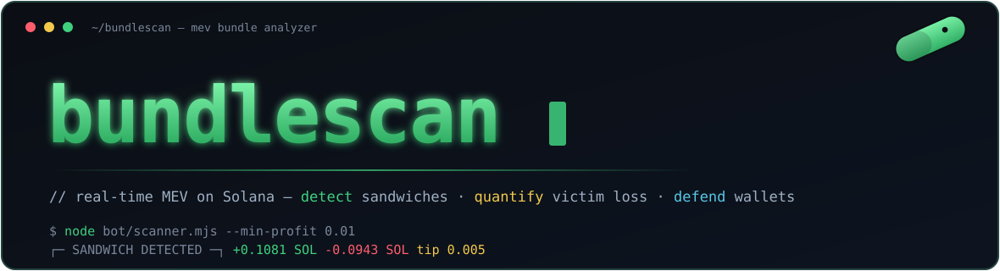

<p align="center"></p>

<p align="center">
  
  
  
  
  
  
</p>

<p align="center">
  <b><a href="#01--what-is-this">[ intel ]</a></b> ·
  <b><a href="#02--quick-start">[ boot ]</a></b> ·
  <b><a href="#03--how-it-works">[ pipeline ]</a></b> ·
  <b><a href="#04--detection">[ detection ]</a></b> ·
  <b><a href="#05--arsenal">[ arsenal ]</a></b> ·
  <b><a href="#06--dashboard">[ war room ]</a></b> ·
  <b><a href="#07--modules">[ internals ]</a></b> ·
  <b><a href="#08--scope">[ rules of engagement ]</a></b>
</p>

<p align="center"></p>

<a id="01--what-is-this"></a>

```
  ┌─[ 01 ]────────────────────────────────────────────────────────────┐
  │  W H A T   I S   T H I S                                           │
  └────────────────────────────────────────────────────────────────────┘
```

**bundlescan reads the chain so you don't get eaten.** It watches Solana
blocks in real time, groups transactions into **bundles**, and flags the
predators hiding inside them — **sandwich attacks**, **arbitrage**,
**liquidations**. For every hit it tells you *who* attacked, *who* got hit,
*how much* was extracted, and *how much* the victim lost.

It is a **defensive / research** instrument. It **detects and measures** MEV.
It does **not** execute it — there is no attack engine here (see
[rules of engagement](#08--scope)).

```
     predators                          bundlescan
  ─────────────────                  ──────────────────
   sandwich bots      ──────►          detect  ●
   arb searchers      ──────►          classify ●       ──►  you,
   snipers            ──────►          quantify ●            armed with
   tip spammers       ──────►          record   ●            the numbers
```

<p align="center"></p>

<a id="02--quick-start"></a>

```
  ┌─[ 02 ]────────────────────────────────────────────────────────────┐
  │  Q U I C K   S T A R T                                            │
  └────────────────────────────────────────────────────────────────────┘
```

Three commands and you're watching the mempool.

```bash
git clone https://github.com/zostaff/bundlescan.git && cd bundlescan
npm install                      # Node.js 22+, ESM only
cp .env.example .env             # then drop in a real RPC
```

A real RPC endpoint matters — the public `api.mainnet-beta.solana.com`
rate-limits block fetches hard. Helius is recommended:

```env
HELIUS_API_KEY=your_key_here
# ...or a full custom endpoint:
# RPC_URL=https://mainnet.helius-rpc.com/?api-key=YOUR_KEY
# RPC_WSS=wss://mainnet.helius-rpc.com/?api-key=YOUR_KEY
```

Go live:

```bash
node bot/scanner.mjs                       # watch MEV in real time
node bot/wallet-guard.mjs <your_wallet>    # alert if YOU get sandwiched
node bot/stats.mjs --hours 24              # aggregate the last 24h
node bot/simulator-cli.mjs <signature>     # "what if this tx were sandwiched?"
node dashboard/server.mjs                  # war room -> http://localhost:3001
```

<p align="center"></p>

<a id="03--how-it-works"></a>

```
  ┌─[ 03 ]────────────────────────────────────────────────────────────┐
  │  H O W   I T   W O R K S                                          │
  └────────────────────────────────────────────────────────────────────┘
```

Every confirmed slot is pulled, decoded, bundled, and scanned. The whole
pipeline is read-only.

```
   chain tip
      │
      ▼
 ┌──────────────────────┐
 │  listener.mjs        │  walk slots forward, rate-limited (≤5 getBlock/s)
 │  block stream        │  each slot cached — fetched exactly once
 └──────────┬───────────┘
            │  { slot, block }
            ▼
 ┌──────────────────────┐
 │  tx-decoder.mjs      │  normalize every tx (versioned-aware, ALT keys)
 │                      │  → signer, fee, ix, inner-ix, balance & token deltas
 └──────────┬───────────┘
            │  decoded[]
            ▼
 ┌──────────────────────┐
 │  bundle-detector.mjs │  group by slot: tip transfer to a known tip account,
 │                      │  or one signer across multiple txs  → a bundle
 └──────────┬───────────┘
            │
      ┌─────┴───────────────┬──────────────────────┐
      ▼                     ▼                      ▼
 ┌──────────┐        ┌──────────────┐        ┌──────────────┐
 │ sandwich │        │ arb-detector │        │ trade-parser │
 │ detector │        │              │        │ pump.fun V3  │
 └────┬─────┘        └──────┬───────┘        └──────────────┘
      │                     │
      ▼                     ▼
 ┌────────────────────────────────────┐
 │ profit-calc · victim-calc          │  BigInt lamports, bonding-curve math
 └──────────────┬─────────────────────┘
                │
                ▼
      store.jsonl  ─────►  stats.mjs  ·  dashboard
```

Design rules baked in:

| rule | where |
|---|---|
| all money math is **BigInt lamports** | `profit-calc`, `victim-calc`, `bonding-curve` |
| `maxSupportedTransactionVersion` starts `0`, **auto-escalates** | `rpc.mjs` |
| inner-instruction (CPI) parsing for trade events | `trade-parser`, `tx-decoder` |
| rate limit ≤5 `getBlock`/s, each block cached once | `rpc.mjs` |
| dashboard is **vanilla** HTML/CSS/JS — no frameworks | `dashboard/` |
| `SIGINT` prints a session report | every bot |

<p align="center"></p>

<a id="04--detection"></a>

```
  ┌─[ 04 ]────────────────────────────────────────────────────────────┐
  │  D E T E C T I O N                                                │
  └────────────────────────────────────────────────────────────────────┘
```

### Bundles

A **bundle** is a group of transactions in **one slot** glued together by a
tip to a known tip account — or one signer landing several txs in the same
slot. bundlescan knows the 8 Jito tip accounts and recognises Astralane
(`astr…`) and Nozomi (`noz…`) by prefix.

### Sandwich

Three trades on **one mint**, in block order, with the attacker on the outside:

```
   tx order ──►      BUY            BUY            SELL
                 ┌─────────┐    ┌─────────┐    ┌─────────┐
                 │ ATTACKER│    │ VICTIM  │    │ ATTACKER│
                 │ front   │    │ worse   │    │ back    │
                 │ -run    │    │ price   │    │ -run    │
                 └────┬────┘    └────┬────┘    └────┬────┘
                      │              │              │
   same signer ◄──────┴──────────────┼──────────────┘
   different   ◄─────────────────────┘
   + tip transfer in one of the attacker's txs

   profit = back.sol_received − front.sol_spent − tip − fees
   loss   = tokens_victim_WOULD_have_had (pre-attack curve) − tokens_received
```

### Live output

```
┌─ SANDWICH DETECTED ──────────────┐
│ Attacker: 7xKX…AsU               │
│ Victim:   9pMH…Bgm               │
│ Token:    DYdf…pump              │
│ Slot:     467686675  tx 12/13/15 │
│ Profit:   +0.1081 SOL            │   ← green
│ Loss:     -0.0943 SOL            │   ← red
│ Tip:      0.0050 SOL (jito)      │   ← yellow
└──────────────────────────────────┘
```

### pump.fun V3 trade event

Decoded straight from the self-CPI event log / `Program data:` lines:

```
 V3 Trade Event (390–391 bytes)
 ──────────────────────────────
 offset  size   field
 0       8      discriminator   bddb7fd34ee661ee
 8       32     mint            token address
 40      8      sol amount      lamports  (u64 LE)
 48      8      token amount    raw units (u64 LE)
 57      32     user            trader pubkey
 97      8      virtual SOL      reserves after trade
 105     8      virtual token    reserves after trade
```

Direction (`buy` / `sell`) comes from the `Instruction: Buy/BuyV2/BuyV3 /
Sell/SellV2/SellV3` log line, with a SOL-flow fallback.

<p align="center"></p>

<a id="05--arsenal"></a>

```
  ┌─[ 05 ]────────────────────────────────────────────────────────────┐
  │  A R S E N A L                                                    │
  └────────────────────────────────────────────────────────────────────┘
```

| bot | what it does | flags |
|---|---|---|
| `scanner.mjs` | live MEV feed with boxed alerts, writes the store | `--min-profit <sol>` · `--token <mint>` |
| `wallet-guard.mjs` | alerts when **your** wallet is the victim, recommends slippage | `<wallet_address>` |
| `stats.mjs` | totals, top attackers, top tokens, avg & fattest | `--hours <n>` · `--top <n>` |
| `simulator-cli.mjs` | analytical "what-if" sandwich on one tx | `<signature>` · `--amount <sol>` |

```bash
node bot/scanner.mjs --min-profit 0.05 --token <mint>   # focus one token
node bot/wallet-guard.mjs <wallet>                       # defend a wallet
node bot/stats.mjs --hours 48 --top 10                   # the leaderboard
node bot/simulator-cli.mjs <sig> --amount 0.5            # measure the harm
```

The **simulator** reconstructs pre-trade reserves, sweeps front-run sizes
`0.01–10 SOL` to find the worst-case attack, and reports attacker profit,
victim loss, and the **slippage tolerance that would have rejected the trade**
— so a victim knows exactly how tight to set it next time.

<p align="center"></p>

<a id="06--dashboard"></a>

```
  ┌─[ 06 ]────────────────────────────────────────────────────────────┐
  │  W A R   R O O M                                                  │
  └────────────────────────────────────────────────────────────────────┘
```

`node dashboard/server.mjs` → `http://localhost:3001` (set `DASHBOARD_PORT`
if it's taken). Dark, monospace, vanilla JS, auto-refreshes every 5s: live
sandwich feed, 24h stat cards, top-attacker / top-token leaderboards, and a
box to decode or simulate any signature.

```
  ┌────────────────────────────────────────────────────────────────┐
  │ bundlescan                              live · 10:28:30   ● live │
  ├───────────────┬───────────────┬───────────────┬────────────────┤
  │ SANDWICHES 24h│ ARBS 24h      │ EXTRACTED     │ VICTIM LOSS     │
  │      128      │      54       │  +31.0050 SOL │  -9.4411 SOL    │
  ├───────────────┴───────────────┴───────────────┴────────────────┤
  │ LIVE SANDWICHES          │ TOP ATTACKERS (24h)                  │
  │ slot  atk    vic   tok   │ 7xKX…AsU   42x   +8.91 SOL           │
  │ …                        │ …                                    │
  └──────────────────────────┴──────────────────────────────────────┘
```

| method | endpoint | returns |
|:---:|---|---|
| `GET` | `/api/recent?limit=50` | latest sandwich detections |
| `GET` | `/api/stats?hours=24` | totals + leaderboards |
| `GET` | `/api/wallet/:addr` | attacks where `addr` was the victim |
| `GET` | `/api/tx/:sig` | decode + classify one transaction |
| `GET` | `/api/simulate/:sig?amount=0.5` | analytical what-if |

<p align="center"></p>

<a id="07--modules"></a>

```
  ┌─[ 07 ]────────────────────────────────────────────────────────────┐
  │  I N T E R N A L S                                                │
  └────────────────────────────────────────────────────────────────────┘
```

Every `lib/` module is usable on its own.

```
 lib/
 ├─ tx-decoder.mjs        normalize any tx (versioned, ALT-aware)
 ├─ trade-parser.mjs      extract pump.fun V3 trade events
 ├─ bundle-detector.mjs   find bundles in a block (tip / shared signer)
 ├─ sandwich-detector.mjs the buy→buy→sell pattern matcher
 ├─ arb-detector.mjs      multi-hop, SOL-positive, round-trip arb
 ├─ bonding-curve.mjs     constant-product (x·y=k) math, BigInt
 ├─ profit-calc.mjs       attacker profit from balance deltas
 ├─ victim-calc.mjs       victim loss vs pre-attack reserves
 ├─ simulator.mjs         analytical sandwich what-if (read-only)
 ├─ jito.mjs              READ-ONLY Jito client (tips, status)
 ├─ listener.mjs          forward block stream
 ├─ rpc.mjs               rate-limited + cached RPC
 ├─ store.mjs             append-only JSONL, BigInt-safe
 ├─ logger.mjs            ANSI colour + boxed panels
 ├─ config.mjs            .env loader
 └─ constants.mjs         program IDs, tip accounts, layouts
```

**Stack:** Node.js 22+ · ESM · `@solana/web3.js` · `@solana/spl-token` ·
`bs58` · `dotenv` · `ws`.

<p align="center"></p>

<a id="08--scope"></a>

```
  ┌─[ 08 ]────────────────────────────────────────────────────────────┐
  │  R U L E S   O F   E N G A G E M E N T                            │
  └────────────────────────────────────────────────────────────────────┘
```

bundlescan is deliberately **one-sided** — it's armour, not a weapon.

```
   ✔ detect        ✔ classify      ✔ quantify      ✔ defend
   ✘ front-run     ✘ back-run      ✘ build bundles ✘ submit attacks
```

- **No execution engine.** There is no transaction builder that constructs or
  submits sandwich bundles. That is the component that takes money from
  victims, and it is intentionally absent.
- **`jito.mjs` is read-only** — tip accounts, tip floor, bundle status. It
  cannot send bundles.
- **`simulator.mjs` is pure analysis** — it reports what an attack *would* cost
  so you can protect yourself; it is wired to nothing that trades.

Use it to study MEV, to measure what's being extracted, and to tune your own
slippage so the sandwich bots pass you by.

<p align="center"></p>

<p align="center"><sub>for research &amp; defensive use · built on public on-chain data · not affiliated with pump.fun or Jito</sub></p>
