<p align="center"></p>

<p align="center">
  
  
  
  
  
  
</p>

<p align="center">
  <b><a href="#01--what-is-this">[ intel ]</a></b> ·
  <b><a href="#02--quick-start">[ boot ]</a></b> ·
  <b><a href="#03--how-it-works">[ pipeline ]</a></b> ·
  <b><a href="#04--detection">[ detection ]</a></b> ·
  <b><a href="#05--arsenal">[ arsenal ]</a></b> ·
  <b><a href="#06--dashboard">[ war room ]</a></b> ·
  <b><a href="#07--modules">[ internals ]</a></b> ·
  <b><a href="#08--scope">[ rules of engagement ]</a></b>
</p>

<p align="center"></p>

<a id="01--what-is-this"></a>

<p align="center"></p>

**bundlescan reads the chain so you don't get eaten.** It watches Solana
blocks in real time, groups transactions into **bundles**, and flags the
predators hiding inside them: **sandwich attacks**, **arbitrage**,
**liquidations**. For every hit it tells you *who* attacked, *who* got hit,
*how much* was extracted, and *how much* the victim lost.

It is a **defensive / research** instrument. It **detects and measures** MEV.
It does **not** execute it: there is no attack engine here (see
[rules of engagement](#08--scope)).

<p align="center">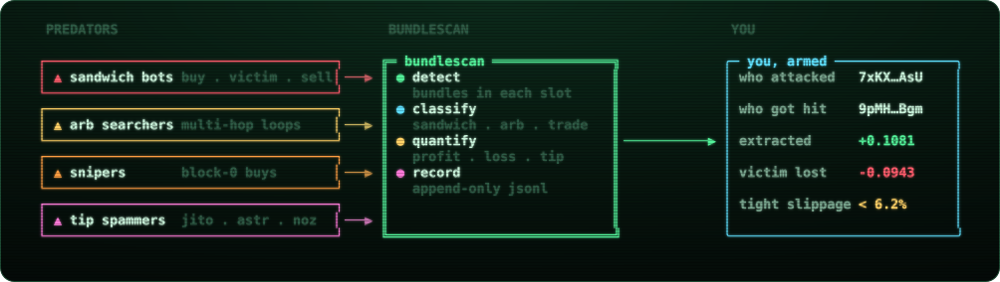</p>

<p align="center"></p>

<a id="02--quick-start"></a>

<p align="center"></p>

Three commands and you're watching the mempool.

```bash
git clone https://github.com/zostaff/bundlescan.git && cd bundlescan
npm install                      # Node.js 22+, ESM only
cp .env.example .env             # then drop in a real RPC
```

A real RPC endpoint matters: the public `api.mainnet-beta.solana.com`
rate-limits block fetches hard. Helius is recommended:

```env
HELIUS_API_KEY=your_key_here
# ...or a full custom endpoint:
# RPC_URL=https://mainnet.helius-rpc.com/?api-key=YOUR_KEY
# RPC_WSS=wss://mainnet.helius-rpc.com/?api-key=YOUR_KEY
```

Go live:

```bash
node bot/scanner.mjs                       # watch MEV in real time
node bot/wallet-guard.mjs <your_wallet>    # alert if YOU get sandwiched
node bot/stats.mjs --hours 24              # aggregate the last 24h
node bot/simulator-cli.mjs <signature>     # "what if this tx were sandwiched?"
node dashboard/server.mjs                  # war room -> http://localhost:3001
```

<p align="center"></p>

<a id="03--how-it-works"></a>

<p align="center"></p>

Every confirmed slot is pulled, decoded, bundled, and scanned. The whole
pipeline is read-only.

<p align="center">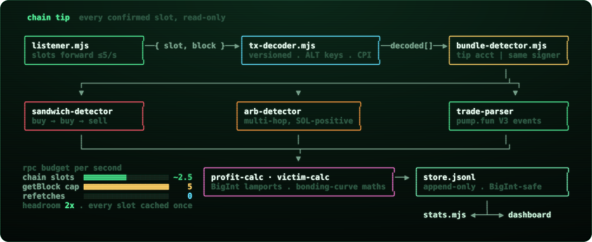</p>

<p align="center">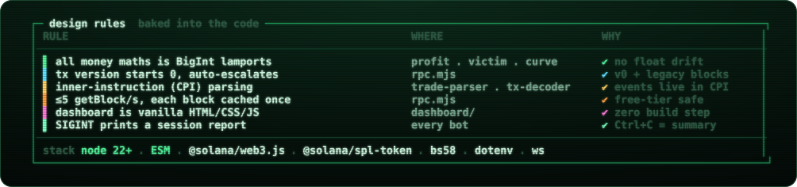</p>

<p align="center"></p>

<a id="04--detection"></a>

<p align="center"></p>

### Bundles

A **bundle** is a group of transactions in **one slot** glued together by a
tip to a known tip account, or one signer landing several txs in the same
slot. bundlescan knows the 8 Jito tip accounts and recognises Astralane
(`astr…`) and Nozomi (`noz…`) by prefix.

### Sandwich

Three trades on **one mint**, in block order, with the attacker on the outside:

<p align="center">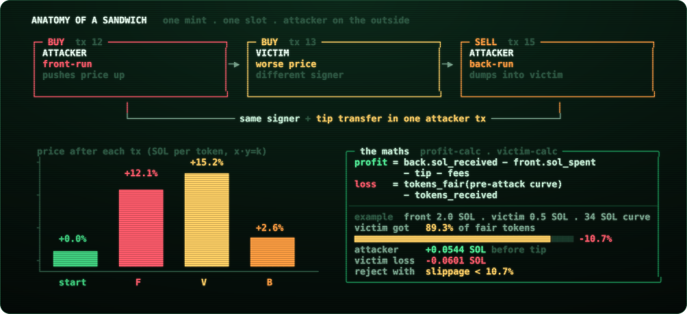</p>

### Live output

<p align="center">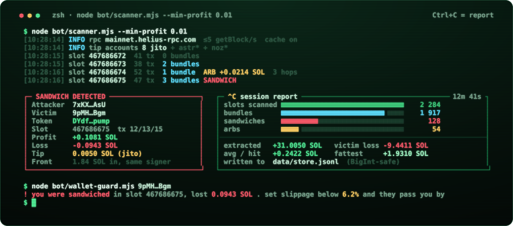</p>

### pump.fun V3 trade event

Decoded straight from the self-CPI event log / `Program data:` lines:

<p align="center">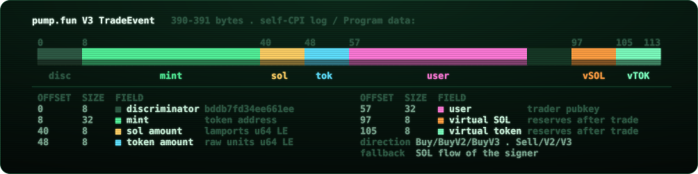</p>


Direction (`buy` / `sell`) comes from the `Instruction: Buy/BuyV2/BuyV3 /
Sell/SellV2/SellV3` log line, with a SOL-flow fallback.

<p align="center"></p>

<a id="05--arsenal"></a>

<p align="center"></p>

<p align="center">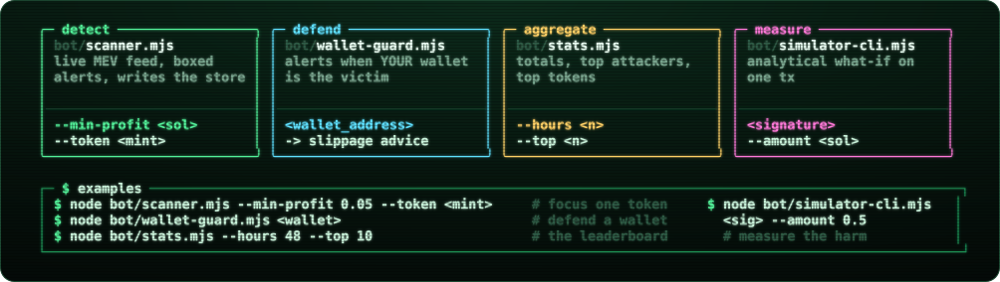</p>

| bot | what it does | flags | reads | writes |
|---|---|---|:---:|:---:|
| `scanner.mjs` | live MEV feed with boxed alerts | `--min-profit <sol>` · `--token <mint>` | chain | store |
| `wallet-guard.mjs` | alerts when **your** wallet is the victim, recommends slippage | `<wallet_address>` | chain | stdout |
| `stats.mjs` | totals, top attackers, top tokens, avg & fattest | `--hours <n>` · `--top <n>` | store | stdout |
| `simulator-cli.mjs` | analytical "what-if" sandwich on one tx | `<signature>` · `--amount <sol>` | one tx | stdout |

```bash
node bot/scanner.mjs --min-profit 0.05 --token <mint>   # focus one token
node bot/wallet-guard.mjs <wallet>                       # defend a wallet
node bot/stats.mjs --hours 48 --top 10                   # the leaderboard
node bot/simulator-cli.mjs <sig> --amount 0.5            # measure the harm
```

The **simulator** reconstructs pre-trade reserves, sweeps front-run sizes
`0.01–10 SOL` to find the worst-case attack, and reports attacker profit,
victim loss, and the **slippage tolerance that would have rejected the trade**,
so a victim knows exactly how tight to set it next time.

<p align="center">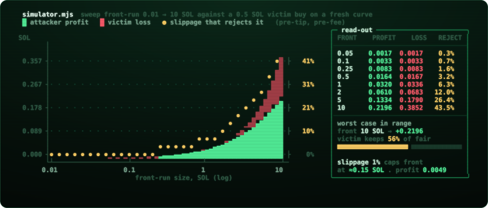</p>

| front-run | attacker profit | victim loss | slippage that rejects it |
|---:|---:|---:|---:|
| 0.1 SOL | 0.0033 SOL | 0.0033 SOL | 0.7% |
| 0.5 SOL | 0.0164 SOL | 0.0167 SOL | 3.2% |
| 1 SOL | 0.0320 SOL | 0.0336 SOL | 6.3% |
| 2 SOL | 0.0610 SOL | 0.0683 SOL | 12.0% |
| 10 SOL | 0.2196 SOL | 0.3852 SOL | 43.5% |

<sub>0.5 SOL victim buy on a fresh curve (30 SOL / 1.073B virtual reserves), pre-tip and pre-fee, computed with <code>lib/bonding-curve.mjs</code>. A 1% slippage setting caps a profitable front-run at about 0.15 SOL.</sub>

<p align="center"></p>

<a id="06--dashboard"></a>

<p align="center"></p>

`node dashboard/server.mjs` → `http://localhost:3001` (set `DASHBOARD_PORT`
if it's taken). Dark, monospace, vanilla JS, auto-refreshes every 5s: live
sandwich feed, 24h stat cards, top-attacker / top-token leaderboards, and a
box to decode or simulate any signature.

<p align="center">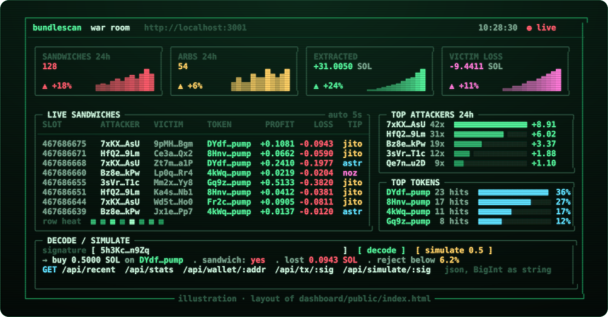</p>

| method | endpoint | params | returns | feeds panel |
|:---:|---|---|---|---|
| `GET` | `/api/recent` | `limit=50` | latest sandwich detections | live sandwiches |
| `GET` | `/api/stats` | `hours=24` | totals + leaderboards | stat cards · top attackers · top tokens |
| `GET` | `/api/wallet/:addr` | wallet pubkey | attacks where `addr` was the victim | API only |
| `GET` | `/api/tx/:sig` | signature | decode + classify one transaction | decode box |
| `GET` | `/api/simulate/:sig` | `amount=0.5` | analytical what-if | decode box, simulate |

<p align="center"></p>

<a id="07--modules"></a>

<p align="center"></p>

Every `lib/` module is usable on its own.

<p align="center">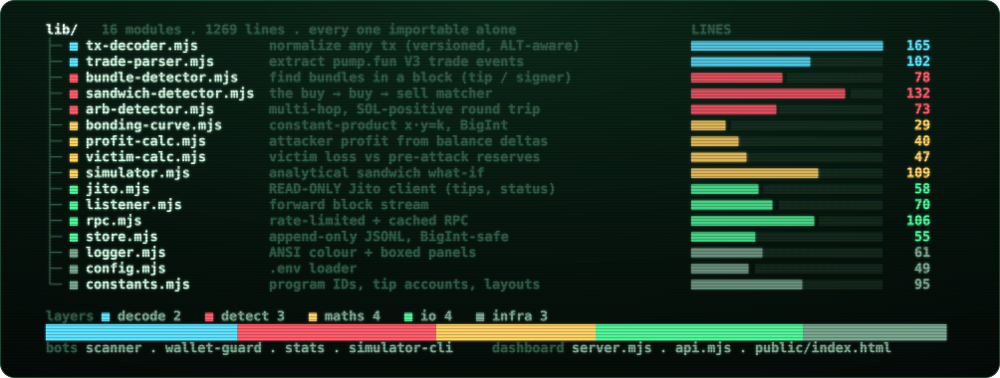</p>

**Stack:** Node.js 22+ · ESM · `@solana/web3.js` · `@solana/spl-token` ·
`bs58` · `dotenv` · `ws`.

<p align="center"></p>

<a id="08--scope"></a>

<p align="center"></p>

bundlescan is deliberately **one-sided**: it's armour, not a weapon.

<p align="center">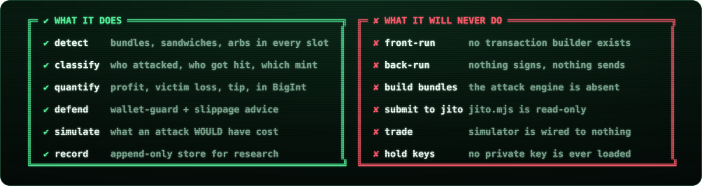</p>

- **No execution engine.** There is no transaction builder that constructs or
  submits sandwich bundles. That is the component that takes money from
  victims, and it is intentionally absent.
- **`jito.mjs` is read-only**: tip accounts, tip floor, bundle status. It
  cannot send bundles.
- **`simulator.mjs` is pure analysis**: it reports what an attack *would* cost
  so you can protect yourself; it is wired to nothing that trades.

Use it to study MEV, to measure what's being extracted, and to tune your own
slippage so the sandwich bots pass you by.

<p align="center"></p>

<p align="center"><sub>for research &amp; defensive use · built on public on-chain data · not affiliated with pump.fun or Jito</sub></p>
